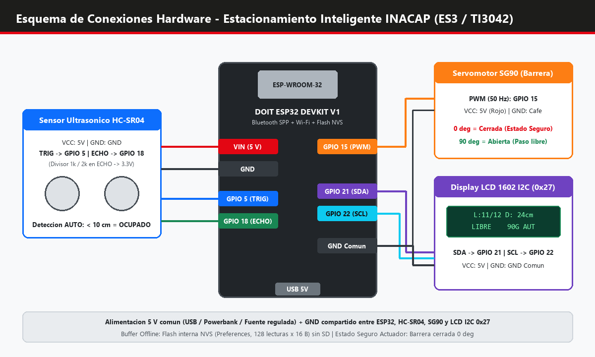

# Sistema de Estacionamiento Inteligente y Control de Barrera IoT/OT (`INACAP-Barrera-IoT`)

Aplicación móvil nativa Android (**Kotlin + Jetpack Compose + Material Design 3 + MVVM + Room SQLite**) integrada con firmware C++ para **ESP32** (`DOIT ESP32 DEVKIT V1`), diseñada bajo lineamientos de ciberseguridad **ISO/IEC 27000** e **ISO/IEC 27400** para la Evaluación Sumativa 3 de **TI3042 — Aplicaciones Móviles para IoT**.

---

## 1. Datos del proyecto

| | |
|---|---|
| Integrantes | Daniel Melimán · Marcelo Díaz |
| Sección | TI3042 — Dupla 07 |
| Problema que resuelve | Los accesos de estacionamientos básicos suelen operar sin conteo remoto de plazas disponibles desde la entrada, sin autenticación de comandos y perdiendo trazabilidad o bloqueando la barrera ante cortes inalámbricos. Este sistema centraliza la supervisión de plazas libres, controla la barrera con validación estricta y conserva eventos sin conexión en Room (Android) y Flash NVS (ESP32). |
| Qué hace el sistema | Mide presencia/distancia vehicular en el acceso (`HC-SR04`), actualiza plazas libres y muestra el estado en un display `LCD 1602 I2C (0x27)` desde la entrada, acciona la barrera con un servomotor `SG90` (`0°` cerrada / `90°` abierta) en modo `AUTO` o `MANUAL`, y sincroniza telemetría, `ACK`/`ERR` y registros offline con marca de hora legible en la app Android. |
| Placa | ESP32 DevKitC V4 (`DOIT ESP32 DEVKIT V1`) |
| Sensores | Sensor ultrasónico `HC-SR04` (`TRIG` GPIO 5, `ECHO` GPIO 18) |
| Actuadores | Servomotor `SG90` (`GPIO 15`, PWM 50 Hz) y Display `LCD 1602 I2C` dirección `0x27` (`SDA` GPIO 21, `SCL` GPIO 22) |
| Enlace | Bluetooth Clásico RFCOMM (SPP UUID `00001101-0000-1000-8000-00805F9B34FB`) y Sockets TCP por Wi-Fi Local (puerto `8888`, opcional vía `ENABLE_WIFI_TCP`) |
| Quién hizo qué | Daniel Melimán: App Android (Kotlin/Compose/MVVM/Room), capa de seguridad ISO 27400, protocolo JSON y firmware ESP32 con buffer NVS · Marcelo Díaz: Integración hardware/protoboard (HC-SR04, SG90, LCD I2C), pruebas de enlace, validación de casos ES3 y documentación |

---

## 2. Esquema de conexiones



*(También disponible en formato vectorial en [`docs/esquema_conexiones.svg`](docs/esquema_conexiones.svg) y proyecto Wokwi heredado de Unidad 1 en [`esp32/wokwi/diagram.json`](esp32/wokwi/diagram.json) + [`esp32/wokwi/libraries.txt`](esp32/wokwi/libraries.txt)).*

| Pin ESP32 | Componente | Observación |
|---|---|---|
| `GPIO 5` | HC-SR04 `TRIG` | Salida digital; pulso de disparo de `10 µs` cada `250 ms` |
| `GPIO 18` | HC-SR04 `ECHO` | Entrada digital; mide eco con `pulseIn(..., 25000)`. Se recomienda divisor resistivo `1 kΩ / 2 kΩ` para adaptar `5 V -> 3.3 V` |
| `GPIO 15` | Servomotor SG90 `PWM` | Señal PWM `50 Hz` (`500–2400 µs`); `0°` = Barrera Cerrada (estado seguro), `90°` = Barrera Abierta |
| `GPIO 21` | LCD 1602 I2C `SDA` | Bus I2C datos, dirección `0x27`, muestra plazas libres/capacidad y estado desde la entrada |
| `GPIO 22` | LCD 1602 I2C `SCL` | Bus I2C reloj (`100 kHz`) |
| `VIN` / `5 V` | HC-SR04 `VCC`, SG90 `VCC`, LCD `VCC` | Alimentación regulada común de `5 V` (USB / Powerbank / fuente externa) |
| `GND` | HC-SR04, SG90, LCD I2C | Tierra (`GND`) común compartida con el ESP32 |

---

## 3. Protocolo de comunicación

**Formato de trama:** Objetos JSON en una sola línea delimitados por salto de línea (`\n`).  
**Largo máximo:** `512 bytes` en el ESP32 (`MAX_FRAME_BYTES = 512`) y `1024 bytes` en el parser de la app (`ProtocolFrameParser.MAX_FRAME_LENGTH`).  
**Qué pasa con una trama incompleta o corrupta:** Si llega sin `\n`, vacía, truncada (sin `{...}`), excede el largo máximo o tiene JSON inválido, se descarta inmediatamente sin bloquear el `loop()` ni cerrar la app; el ESP32 responde `{"type":"ERR","status":"ERR","code":"CORRUPT_FRAME",...}\n` y la app registra `ERR [MALFORMED_JSON]` en la bitácora y en Room sin alterar el actuador.

| Dirección | Comando / Trama | Parámetros | Rango válido | Respuesta |
|---|---|---|---|---|
| App → ESP32 | `SET_BARRERA` | `val` (`Int`), `modo`, `token`, `reqId` | `val` ∈ `{0, 90}` | `ACK` + `TELEMETRY`, o `ERR:OUT_OF_RANGE` / `ERR:UNAUTHORIZED` |
| App → ESP32 | `SET_MODO` | `modo` (`String`), `token`, `reqId` | `modo` ∈ `{"AUTO","MANUAL"}` | `ACK` + `TELEMETRY`, o `ERR:OUT_OF_RANGE` |
| App → ESP32 | `SET_UMBRAL` | `val` (`Int`, cm), `token`, `reqId` | `5..150` cm | `ACK` + `TELEMETRY`, o `ERR:OUT_OF_RANGE` |
| App → ESP32 | `SET_CAPACIDAD` | `val` (`Int`), `token`, `reqId` | `1..200` plazas | `ACK` + `TELEMETRY`, o `ERR:OUT_OF_RANGE` |
| App → ESP32 | `SET_PLAZAS` | `val` (`Int`), `token`, `reqId` | `0..capacidadTotal` | `ACK` + `TELEMETRY`, o `ERR:OUT_OF_RANGE` |
| App → ESP32 | `REQ_STATUS` | `token`, `reqId` | — | `ACK` + `TELEMETRY` inmediata |
| App → ESP32 | `SYNC_RECORD` | `val`, `modo`, `token`, `reqId` | — | `ACK` confirmando registro offline enviado por Room |
| App → ESP32 | `FLUSH_BUFFER` | `token`, `reqId` | — | Emite cada lectura de Flash NVS con `"buffered":true,"age_s":...` + `ACK` final |
| ESP32 → App | `TELEMETRY` | `dist`, `estado`, `barrera`, `modo`, `plazasLibres`, `capacidadTotal`, `umbral`, `uptime_s`, `buffered`, `pendingNvs`, `crc` | `dist` `0..400`, `barrera` `0..90`, `estado` `LIBRE`/`OCUPADO` | La app actualiza indicadores, LCD virtual, reloj legible y guarda en Room |

Ejemplo de telemetría periódica automática (cada `1000 ms` con `millis()`, sin `delay()` bloqueante):
```json
{"type":"TELEMETRY","dist":8,"estado":"OCUPADO","barrera":0,"modo":"AUTO","plazasLibres":11,"capacidadTotal":12,"umbral":10,"uptime_s":120,"buffered":false,"pendingNvs":0,"crc":"OK-4B1E"}
```

**Códigos de error:** `UNKNOWN_CMD`, `OUT_OF_RANGE`, `CORRUPT_FRAME`, `MALFORMED_JSON`, `UNAUTHORIZED`.

---

## 4. Seguridad

| # | Control | Cómo está aplicado (archivo/línea) | Cómo lo comprobaron |
|---|---|---|---|
| 1 | Almacén cifrado `AES256_GCM` + Hashing `SHA-256` con Salt (`16 B`) y Pepper (`32 B`) | `app/src/main/java/com/example/security/SecurityManager.kt` líneas `42-50` (`EncryptedSharedPreferences.create` con `AES256_SIV`/`AES256_GCM`) y líneas `90-95` (`hashPasswordSha256` + `MessageDigest.isEqual` en tiempo constante) | Registro inicial obligatorio sin claves por defecto; inspección de logs verificando que nunca aparece la clave ni el token completo (`maskToken` + `redactSensitiveFields`) |
| 2 | Token de sesión obligatorio en todos los comandos OT | `esp32/sketch_estacionamiento_iot.ino` líneas `436-457` (`validarTokenOt` dentro de `procesarTramaComando`) y `SecurityManager.kt` línea `193` (`isValidCommandToken`) | Botón **Probar ERR: Token inválido** (`token="BAD"`) en la app: el ESP32 responde `ERR:UNAUTHORIZED` y no mueve la barrera |
| 3 | Whitelist estricta de comandos y rangos + protección de buffer | `esp32/sketch_estacionamiento_iot.ino` líneas `445-516` (`MAX_FRAME_BYTES = 512`, `extraerValorJsonIntEstricto`, rechazo `UNKNOWN_CMD` y `OUT_OF_RANGE`) | Pruebas con **Cmd inválido** (`OPEN_ROOF_INVALID`), **Fuera de rango (180°)** y **Trama JSON corrupta**: todas devuelven `ERR` sin accionar el servo |
| 4 | PIN de emparejamiento Bluetooth SPP + secretos fuera de Git | `esp32/sketch_estacionamiento_iot.ino` líneas `21-25` (`#include "secrets.h"`) y líneas `165-167` (`SerialBT.setPin(BT_PIN_CODE)`); `.gitignore` líneas `21-27` | Verificación con `git ls-files`: no existen `secrets.h`, `.env`, `*.keystore` ni `*.jks` en el repositorio |

**Qué quedaría expuesto sin estos controles:** Sin autenticación de comandos, PIN Bluetooth ni validación de rangos/buffer, cualquier dispositivo cercano en alcance RFCOMM o Wi-Fi local podría enviar `SET_BARRERA` sin autorización para abrir o cerrar el acceso vehicular, inyectar tramas malformadas para colgar el microcontrolador, o extraer credenciales si quedaran en texto plano en `SharedPreferences` o en el código fuente en GitHub.

**Manejo de credenciales:** En el ESP32, las credenciales reales (`OT_SHARED_TOKEN`, `BT_PIN_CODE`, `WIFI_SSID`, `WIFI_PASS`) se declaran únicamente en `esp32/secrets.h`, archivo excluido del control de versiones en `.gitignore`. En el repositorio se entrega solo la plantilla [`esp32/secrets.example.h`](esp32/secrets.example.h) con valores falsos de ejemplo. En Android, las credenciales de operadores, el *pepper* aleatorio del dispositivo y el token OT se guardan exclusivamente cifrados en `EncryptedSharedPreferences` (`MasterKey.KeyScheme.AES256_GCM`) sin contraseñas hardcodeadas.

**Alineación con ISO 27000:** Se aplicó mínimo privilegio (ningún comando se ejecuta sin token válido y rol autenticado), superficie reducida (solo 8 comandos en lista blanca, puerto TCP desactivado por defecto cuando se usa Bluetooth SPP, sin endpoints remotos fijos), cero credenciales por defecto en el repositorio, redacción automática de tokens en bitácoras (`ProtocolFrameParser.redactSensitiveFields`) y falla segura (`0°`) ante pérdida de enlace o corrupción.

---

## 5. Datos personales

| Dato | ¿Viaja por el enlace? | ¿Se guarda? ¿Dónde? | Cómo se protege |
|---|---|---|---|
| Lecturas de distancia (`dist`), estado (`LIBRE`/`OCUPADO`), plazas y ángulo de barrera | Sí (Bluetooth SPP / TCP local) | Sí, en Room SQLite (`sync_records`) y Flash NVS del ESP32 | Son datos técnicos/operacionales anónimos (no identifican personas, patentes ni rostros) |
| ID de operador local (nombre de usuario en la app) | **No** (solo viaja un token efímero `INA-...`) | Sí, localmente en `EncryptedSharedPreferences` (`AES256_GCM`) | Cifrado con AndroidKeyStore; nunca se transmite ni se sube a nube |
| Contraseña del operador | **No** | **No** se guarda en texto plano; solo `Salt (16 B) + Hash SHA-256` | Hash unidireccional con Salt + Pepper por dispositivo en `EncryptedSharedPreferences` |

El sistema **no captura ni transmite datos personales** (no hay cámara, LPR/patentes, RUT, correos ni geolocalización de conductores). Solo circulan métricas anónimas de distancia y ocupación de plazas acompañadas de un token de sesión firmado.

---

## 6. Reconexión y plan de contingencia

**Reconexión automática en la app:** Espera inicial **2 s**, crece **×2** (`2 s → 4 s → 8 s → 16 s`) hasta un tope de **30 s** (`WirelessConnectionManager.calculateExponentialBackoffMs`, línea `559`), sin reiniciar la aplicación y ejecutándose en `Dispatchers.IO`. Reinicia el contador de intentos a `0` apenas restablece el socket.  
**Estados visibles en la pantalla:** `CONECTADO`, `RECONECTANDO` (mostrando intento y segundos hasta próximo reintento), `DESCONECTADO` y `SIN DATOS RECIENTES` (se activa automáticamente tras `8 s` sin recibir telemetría aunque el socket siga abierto).

**Plan de contingencia:**

| Falla | Qué detecta el sistema y cómo | Qué hace | Cómo se recupera |
|---|---|---|---|
| Se pierde el enlace app–ESP32 | En Android: `IOException` / `EOF` en `readStreamLinesLoop`. En ESP32: `!hayClienteActivo()` | Android pasa a `RECONECTANDO` (backoff `2s→30s`), encola eventos en Room (`synced = false`) y muestra aviso. ESP32 guarda lecturas offline en RAM/NVS; si estaba en `MANUAL` > `15 s` sin enlace, cierra barrera a `0°` | Al volver el enlace, Android sincroniza Room y envía `FLUSH_BUFFER`; ESP32 vacía NVS con su marca de tiempo relativa (`age_s`) |
| El ESP32 se apaga o reinicia | Android detecta caída del socket (`IOException`) y entra en `RECONECTANDO`. Al energizar el ESP32, arranca en `anguloBarrera = 0` | Barrera parte cerrada (`0°`), mantiene el conteo de registros NVS previos (`cargarMetadatosNvs`) y espera cliente BT/TCP | Android reconecta automáticamente sin reiniciar la app, dispara `FLUSH_BUFFER` y recupera lecturas previas al corte |
| La app se cierra o se cae | Al reabrir, `MainViewModel` consulta `EncryptedSharedPreferences` y Room (`ParkingDatabase`) | Si "Mantener sesión" estaba activo, restaura sesión; conserva todos los registros pendientes (`synced = false`) en SQLite | Al reconectar el socket, `observeConnectionState()` dispara `syncPendingRoomRecords()` automáticamente |
| Sensor entrega datos inválidos | ESP32 detecta `duracionUs <= 0` o `cm < 2 || cm > 400` en `medirDistanciaUltrasonicaCm()` | Tras `3` lecturas inválidas consecutivas ejecuta `aplicarEstadoSeguro()` (cierra barrera a `0°` y vuelve a `AUTO`) | Al normalizarse el eco del HC-SR04, restablece el conteo de fallos y retoma operación normal |
| Trama JSON corrupta o comando fuera de rango | `procesarTramaComando()` / `ProtocolFrameParser.parseLine()` | Descarta la trama sin mover el servo y responde `ERR` (`CORRUPT_FRAME`, `OUT_OF_RANGE`, `UNKNOWN_CMD`) | Registra evento en bitácora y Room con timestamp legible; el lazo de control sigue operando sin interrupciones |

**Estado seguro del actuador:** **Barrera Cerrada (`0°`)**. Se aplica automáticamente: (1) al energizar o reiniciar el ESP32 (`setup()`), (2) ante `3` fallos seguidos del sensor HC-SR04, y (3) si el enlace con la app permanece caído por más de `15 s` estando en modo `MANUAL`.

---

## 7. Almacenamiento temporal sin conexión

**En la app (Room / SQLite):**  
- **Base de datos y entidad:** `ParkingDatabase` (`inacap_parking_iot_es3.db`) con entidad [`SyncRecordEntity`](app/src/main/java/com/example/data/local/SyncRecordEntity.kt) y DAO [`SyncRecordDao`](app/src/main/java/com/example/data/local/SyncRecordDao.kt). Guarda comandos emitidos sin conexión, telemetrías retenidas, errores `ERR` y tramas recuperadas desde el buffer NVS del ESP32 (`TELEMETRIA_NVS`), cada una con `createdAtMillis` y `syncedAtMillis`.
- **Marcado y sincronización:** Los eventos generados sin conexión se insertan con `synced = false`. Al pasar `ConnectionState` a `Connected`, `MainViewModel.syncPendingRoomRecords()` envía los pendientes en orden cronológico FIFO (`ORDER BY createdAtMillis ASC`) mediante [`ParkingSyncRepository.syncAllPending()`](app/src/main/java/com/example/data/local/ParkingSyncRepository.kt) hacia el endpoint HTTP/HTTPS configurado (si existe, con cabecera `Idempotency-Key`) o sobre el enlace OT (`SYNC_RECORD`), y además solicita `FLUSH_BUFFER` al ESP32.
- **Anti-duplicados y no pérdida:** `SyncRecordEntity` posee un índice `@Index(value = ["uniqueEventKey"], unique = true)` e inserción `@Insert(onConflict = OnConflictStrategy.IGNORE)`. Solo se marca `synced = true` tras confirmación de envío; ante fallo incrementa `retryCount` sin borrar registros.

**En el ESP32 (Flash interna NVS — sin tarjeta SD):**

| Dato | Valor |
|---|---|
| Mecanismo | `Preferences` (NVS — *Non-Volatile Storage* en flash interna del ESP32, namespace `"es3_buf"`) |
| Tamaño de cada lectura | **16 bytes** empaquetados (`struct BufferedReading`: `seq` 4 B + `uptimeSec` 4 B + `distCm` 2 B + `barreraAngle` 1 B + `plazasLibres` 1 B + `capacidadTotal` 1 B + `flags` 1 B + `checksum` 2 B) |
| Espacio asignado | **2 KB** (`2048 bytes` de datos + ~24 B de metadatos `head`/`cnt`/`seq`) dentro de la partición NVS estándar de `20 KB` |
| Lecturas que caben | **128 lecturas** (`MAX_NVS_RECORDS = 128`). A 1 muestra cada `5 s` offline cubre ~10,6 minutos continuos |
| Qué pasa cuando se llena | **Buffer circular:** sobrescribe la lectura más antigua (`nvsHead = (nvsHead + 1) % 128`), manteniendo siempre las últimas 128 lecturas válidas |
| Cómo se protege la flash del desgaste | **Escritura por lotes en RAM (`RAM_BATCH_SIZE = 4`):** acumula 4 muestras en SRAM y escribe en flash NVS solo 1 vez cada `~20 s` (o ante cambio de ocupación), reduciendo en **75 %** las escrituras de flash respecto a guardar cada lectura individual |
| Cómo se vacía al reconectar | Al reconectar, la app envía `{"cmd":"FLUSH_BUFFER",...}\n`; `flushBufferAlCliente()` vuelca primero el lote RAM restante, lee los registros válidos desde la posición más antigua en orden cronológico calculando `age_s = ahora - uptimeSec`, los envía con `"buffered":true` y reinicia `cnt = 0` y `head = 0` en NVS |

---

## 8. Consumo de energía

**Alimentación del prototipo:** Powerbank USB de **5000 mAh** a **5 V** (para demostración móvil), o fuente regulada `5 V / 2 A` en instalación fija.

| Componente | Estado | Corriente (mA) | Fuente del dato | % del tiempo en ese estado | Corriente promedio (mA) |
|---|---|---:|---|---:|---:|
| ESP32 (`ESP-WROOM-32`) | Activo con Bluetooth SPP TX/RX | 130.0 | Datasheet Espressif *ESP32-WROOM-32*, Tabla 5 / Sección RF TX-RX (130 mA típico BT/BLE activo) | 30 % | 39.00 |
| ESP32 (`ESP-WROOM-32`) | Espera activa (Modem-sleep entre ráfagas) | 30.0 | Datasheet Espressif *ESP32 Series*, Tabla consumo CPU 80–240 MHz en espera (20–68 mA; ~30 mA típico sin Wi-Fi) | 70 % | 21.00 |
| Sensor HC-SR04 | Midiendo (ráfaga `10 µs` cada `250 ms`) | 15.0 | Datasheet ElecFreaks *HC-SR04*, *Working Current: 15 mA* | 10 % | 1.50 |
| Sensor HC-SR04 | Reposo entre disparos | 2.0 | Datasheet *HC-SR04*, *Quiescent Current < 2 mA* | 90 % | 1.80 |
| Servomotor SG90 | Moviendo barrera (`0° ↔ 90°`) | 220.0 | Datasheet TowerPro *SG90*, *Running current 100–250 mA* (~220 mA típico sin traba) | 5 % | 11.00 |
| Servomotor SG90 | Reposo manteniendo posición | 10.0 | Datasheet TowerPro *SG90*, *Idle current ~10 mA* | 95 % | 9.50 |
| Display LCD 1602 + Mochila I2C | Encendido con backlight activo | 25.0 | Datasheet *HD44780 / LCM1602* (~2 mA lógica + ~20–23 mA backlight LED) | 100 % | 25.00 |
| Regulador AMS1117 + LED placa | Conversión 5 V→3.3 V + LED PWR | 10.0 | Datasheet *AMS1117-3.3* (*Quiescent 5–10 mA*) + LED indicador | 100 % | 10.00 |
| **Total** | | | | | **118.80 mA** |

**Autonomía estimada** = `5000 mAh × 0,8 ÷ 118,80 mA` = **33,7 horas** (con Wi-Fi TCP activo simultáneamente el consumo promedio del ESP32 sube ~60 mA adicionales, reduciendo la autonomía a ~22,4 horas).

**Consumo de la app en el móvil:** Los factores de gasto son el socket activo en `Dispatchers.IO`, los reintentos de reconexión, la pantalla encendida con animación Compose y las escrituras en Room. Para reducirlo: (1) la lectura usa `BufferedReader.readLine()` bloqueante dentro de `Dispatchers.IO` sin *busy-waiting*, (2) la reconexión usa *exponential backoff* (`2s → 30s`) evitando escaneos o conexiones continuas, (3) las muestras a Room se filtran cada `15 s` durante operación en vivo (guardando inmediato solo eventos/errores), y (4) las animaciones usan `animateFloatAsState` sin recomposiciones innecesarias.

**Decisiones para ahorrar energía:** Se eligió muestreo del HC-SR04 cada `250 ms` y telemetría cada `1000 ms` (equilibrio entre respuesta rápida de barrera y bajo tráfico RF), Bluetooth Clásico SPP como transporte principal (menor consumo que Wi-Fi STA permanente, dejando `ENABLE_WIFI_TCP = 0` por defecto), escritura por lotes en NVS cada 4 muestras para evitar ciclos continuos de programación flash (~20 mA adicionales en escritura), y backoff exponencial en Android.

**Despliegue real en estacionamiento:** En operación real en la entrada de un estacionamiento el nodo ESP32 + servo + LCD **va conectado a alimentación fija de red (fuente `5 V / 2 A` o `12 V` con reductor buck)**, por lo que la batería queda únicamente como respaldo UPS/powerbank ante cortes eléctricos; no obstante, el cálculo anterior valida su autonomía en respaldo o maqueta portátil.

---

## 9. Compatibilidad

| | |
|---|---|
| `minSdk` | `24` (Android 7.0 Nougat) — requerido por `MasterKey.KeyScheme.AES256_GCM` / `EncryptedSharedPreferences` (`androidx.security:security-crypto`) y cobertura >97 % de dispositivos activos |
| `targetSdk` | `36` (Android 16) — cumple permisos Bluetooth granulares de Android 12+ (`BLUETOOTH_SCAN`, `BLUETOOTH_CONNECT`) y APIs vigentes |
| Arquitecturas / ABIs | `arm64-v8a`, `armeabi-v7a`, `x86_64`, `x86` (declaradas en `app/build.gradle.kts` bloque `ndk.abiFilters`) |

| Dispositivo | Android | Arquitectura | Resultado |
|---|---|---|---|
| Teléfono físico Android (Daniel Melimán) | Android físico (API ≥ 24) | `arm64-v8a` | Pruebas físicas con ESP32 (Bluetooth RFCOMM / Wi-Fi TCP) e instalación directa del APK |
| Emulador Android Studio AVD (`Medium_Phone`) | Android API 37 (Google APIs, 16 KB) | `x86_64` | Verificación multi-ABI (`x86_64`), Room SQLite, `EncryptedSharedPreferences` y pruebas de protocolo `ACK`/`ERR` en Loopback TCP |

*Nota de compatibilidad:* Dado que el segundo integrante utiliza iOS (iPhone), la compatibilidad multi-dispositivo y multi-arquitectura (`arm64-v8a` y `x86_64`) se valida combinando el teléfono físico Android y el emulador AVD de Android Studio.

---

## 10. Cómo compilar y ejecutar

**Firmware (`esp32/sketch_estacionamiento_iot.ino`):**
1. Abrir **Arduino IDE 2.3.x** (o superior) con soporte **ESP32 by Espressif Systems (v2.0.17 o v3.x)**.
2. Seleccionar la placa **DOIT ESP32 DEVKIT V1** (`115200 baud`).
3. Instalar desde el Gestor de Librerías:
   - `ESP32Servo` (Kevin Harrington, `>= 1.1.0`)
   - `LiquidCrystal I2C` (Frank de Brabander, `>= 1.1.2`)
   - (`Wire`, `Preferences` y `BluetoothSerial` vienen incluidas en el core ESP32).
4. Copiar `esp32/secrets.example.h` a `esp32/secrets.h` y configurar `OT_SHARED_TOKEN` y `BT_PIN_CODE` (y `WIFI_SSID`/`WIFI_PASS` si habilita `ENABLE_WIFI_TCP 1`).
5. Compilar y cargar al ESP32. Verificar en Monitor Serie `115200 baud`: `"BARRERA SEG 0G"` en LCD y `"Nodo OT ESP32 listo"`.
6. **Unificación Unidad 1 → Unidad 3 (y prueba en Wokwi):** El firmware unifica el esquema de pines de Unidad 1 (`esp32/wokwi/diagram.json`) corrigiendo el `delay(500)` bloqueante, añadiendo timeout de `25 ms` a `pulseIn()`, arranque en estado seguro `0°`, conteo de plazas en LCD, Bluetooth SPP/Wi-Fi TCP, validación `ACK`/`ERR` y buffer NVS. También puede probarse en **Wokwi** cargando `esp32/sketch_estacionamiento_iot.ino` + `esp32/wokwi/diagram.json` y enviando tramas JSON por el Monitor Serie.

**App Android:**
1. Abrir el proyecto en **Android Studio Ladybug / Meerkat** o superior (JDK 11+, `compileSdk 36.1`, `minSdk 24`).
2. Compilar por CLI (o usar **Build > Build APK(s)** en Android Studio):
   ```bash
   gradle testDebugUnitTest assembleDebug
   ```
3. **APK instalable:** Disponible en la sección **Releases** del repositorio en GitHub (`app-debug.apk` / `INACAP-Barrera-IoT-ES3.apk`).

**Orden de arranque para la demostración (9 min):**
1. Energizar el ESP32 (la barrera inicia en estado seguro `0°` y la LCD muestra plazas libres/distancia).
2. Emparejar Bluetooth `"ESP32_Barrera_INACAP"` en el teléfono Android (ingresando el PIN definido en `secrets.h`).
3. Abrir la app, crear/iniciar operador local, configurar en *Configuración Segura* el mismo `OT_SHARED_TOKEN` (opcional si usa formato `INA-`), elegir rol **1. Estación Control** y transporte **Bluetooth RFCOMM** → pulsar **CONECTAR SOCKET**.
4. Ejecutar las **5 pruebas obligatorias**:
   - **Prueba 1 (Comando inexistente):** Pulsar chip `Probar ERR: Cmd inválido` → ESP32 devuelve `ERR:UNKNOWN_CMD` y no mueve nada.
   - **Prueba 2 (Valor fuera de rango):** Pulsar chip `Probar ERR: Fuera de rango (180°)` → ESP32 devuelve `ERR:OUT_OF_RANGE` y no mueve la barrera.
   - **Prueba 3 (Apagar ESP32):** Desconectar alimentación del ESP32 → la app muestra estado `RECONECTANDO` con backoff creciente (`2s → 4s → 8s...`) y tras `8 s` marca `SIN DATOS RECIENTES` sin reiniciarse.
   - **Prueba 4 (Encender ESP32):** Volver a energizar el ESP32 → la app reconecta sola, envía `FLUSH_BUFFER` y `SYNC_RECORD` (Room), recuperando las lecturas acumuladas en flash NVS.
   - **Prueba 5 (Dato con su hora):** Verificar en el encabezado de plazas, tira `ACK`/`ERR`, bitácora y tarjetas de Room SQLite la marca de hora legible (`yyyy-MM-dd HH:mm:ss`) de lecturas actuales y recuperadas de NVS.

---

## 11. Qué no funcionó y qué mejoraríamos

- El ESP32 mantiene la hora relativa offline mediante `uptime_s` (`millis() / 1000`) cuando opera solo por Bluetooth sin acceso a NTP; al reconectar, la app reconstruye la marca de tiempo exacta restando `age_s` a la hora local del teléfono. Como mejora futura, incorporar un módulo RTC `DS3231` o sincronización de epoch UNIX en el handshake inicial.
- En el cálculo de distancia del `HC-SR04`, objetos blandos o muy inclinados pueden provocar ecos nulos (`pulseIn == 0`); se mitigó exigiendo `3` lecturas inválidas seguidas antes de pasar a estado seguro (`0°`). Como mejora, aplicar filtro de mediana de 5 muestras o sensor láser ToF `VL53L0X`.
- El enlace Bluetooth Clásico RFCOMM no cifra la capa de aplicación por encima del emparejamiento SPP; en Unidad 4 o despliegue productivo se habilitaría TLS/MQTT sobre Wi-Fi (`WiFiClientSecure`) con rotación periódica de tokens HMAC.
